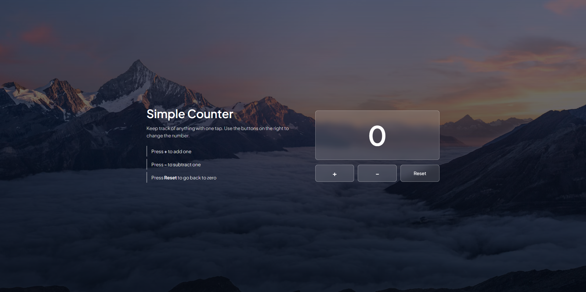

# Click Counter

A simple click counter built with HTML, CSS and JavaScript. Press **+** to add one, **-** to subtract one, and **Reset** to go back to zero. The number never goes below zero.

**Live demo:** https://YOUR-USERNAME.github.io/click-counter/

## Features

- Add, subtract and reset buttons
- The number never goes below zero
- Clean card layout with a gradient background and hover effects

## Built with

- HTML
- CSS
- JavaScript (no libraries)

## What I learned

- Storing a changing value in a variable with `let`
- Reacting to button clicks with `addEventListener`
- Updating the page from JavaScript
- Using `if` to stop the number going below zero

## Run it on your computer

1. Download or clone this repo
2. Open `index.html` in your browser

## Author

[404Architect](https://github.com/OrdinaryPhantom-lgtm)
